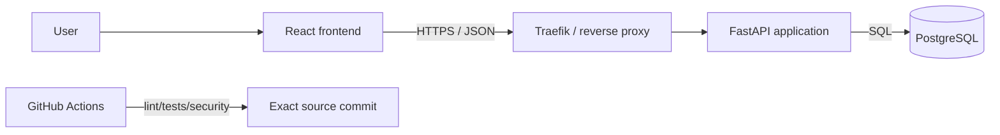

# Architecture review: Secure Backend Platform

**Design proposal, not verification of running deployment.** Project: **Secure Backend Platform** (`secure-backend-platform`, rename from `TESENA_pohovor` pending). Source baseline: Full Stack FastAPI Template; upstream attribution and runtime verification required.

## Context
Users interact with a React/TypeScript UI. FastAPI exposes the backend API and authorization; PostgreSQL stores application data. Docker Compose orchestrates development services, Traefik can route public traffic, and GitHub Actions drives quality checks. Existing configuration and inherited starter components must be distinguished from independently implemented capabilities.

## Architecture invariants
- Every protected request goes through authenticated server-side authorization.
- PostgreSQL changes are wrapped in explicit transactions, with rollback on failure.
- Client-supplied values never authorize administrative actions on their own.
- Test and security evidence must reference an exact source SHA and report status.
- Secrets belong in environment/secret manager, never tracked files or logs.

## ADR proposals
1. Keep a single deployable FastAPI backend unless profiling demonstrates a need to split services.
2. Use PostgreSQL as system of record; no Redis cache unless repeatable performance data proves benefit.
3. Use dedicated test profiles for k6 and security scenarios; never target external or production services without permission.
4. Prefer C4 context/container diagrams and concise ADRs over sprawling unmaintained documentation.

## Verification gaps
Real authorization tests, current compose startup, migration health, k6 load results, scanner evidence and deployment threat assessment: **NOT_RUN / NOT_VERIFIED**. Add evidence to corresponding Issues before publication.
